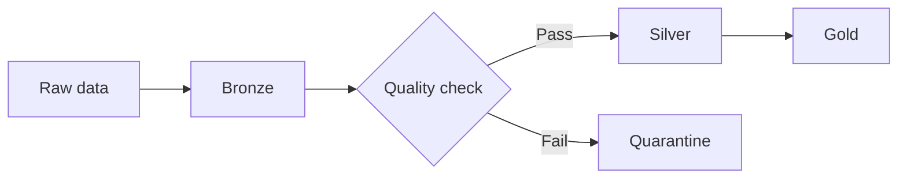

# QAmodule6




```mermaid
flowchart LR
    subgraph Bronze[Bronze layer]
        RawSales[Raw sales]
        RawProducts[Raw products]
    end

    subgraph Silver[Silver layer]
        CleanSales[Clean sales]
        CleanProducts[Clean products]
    end

    RawSales --> CleanSales
    RawProducts --> CleanProducts
    ```
